# Tie-out report: synthetic_affidavit.pdf

- Source SHA-256: `8ce2307edeb8e99a155db9f8e12ec35cae464265f3379916d100ccbe37e65c6a`
- Template: `Dispense_bond`
- Extracted at: 2026-10-02T12:10:09+00:00
- Overall: **PASS**

## Checks

| Check | Result | Detail |
|---|---|---|
| asset_sum_ties_to_stated_total | PASS | `{"asset_rows": 2, "asset_sum": "123750.00", "stated_total": "123750.00", "stated_total_evidence": {"page": 2, "bbox": [105.66, 310.2, 386.95, 322.2]}}` |
| row_integrity_label_and_value_same_band | PASS | `{"rows_checked": 18, "misaligned_rows": []}` |
| debt_rows_match_template | PASS | `{"expected": 16, "extracted": 16, "missing": [], "unexpected": []}` |
| every_row_has_record_specific_evidence | PASS | `{"rows_without_crop": []}` |
| entity_not_copied_from_title | PASS | `{"decedent": "Margaret Holloway", "document_title": "AFFIDAVIT TO DISPENSE WITH THE FILING OF A BOND"}` |

## Line items (row-level evidence)

| Row | Amount type | Label | Value | Amount | Page | Same band | Evidence |
|---|---|---|---|---|---|---|---|
| assets-01 | asset_value | Example Savings Bank Checking Account ending in #0000 | $82,500.00 | 82500.00 | 1 | yes | 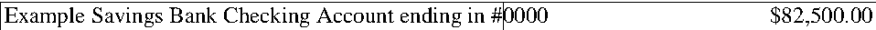 |
| assets-02 | asset_value | Example Brokerage Account ending in #1111 | $41,250.00 | 41250.00 | 1 | yes |  |
| debts-01 | lease_charges_due | Rents or charges due on any lease or apartment | None | 0.00 | 1 | yes |  |
| debts-02 | mortgage_or_notes_outstanding | Amount of any outstanding mortgages or notes | None | 0.00 | 1 | yes |  |
| debts-03 | judgments_outstanding | Amount of any judgments held against the decedent or his estate | None | 0.00 | 1 | yes | 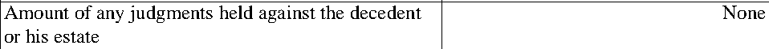 |
| debts-04 | bond_liability | Liability of any bond on which the decedent was a party | None | 0.00 | 1 | yes | 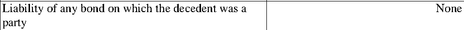 |
| debts-05 | tax_federal_income_due | Federal income taxes due | None | 0.00 | 1 | yes |  |
| debts-06 | tax_ny_income_due | New York State and/or City income taxes due | $1,204.00 | 1204.00 | 1 | yes | 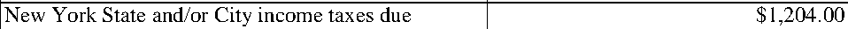 |
| debts-07 | tax_real_estate_due | Real estate taxes due | None | 0.00 | 1 | yes |  |
| debts-08 | tax_federal_estate_due | Federal estate taxes due | Exempt | - | 1 | yes | 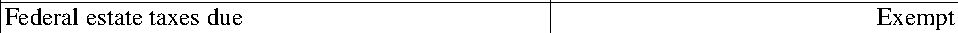 |
| debts-09 | tax_ny_estate_due | New York estate taxes due | Exempt | - | 1 | yes | 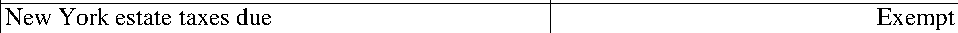 |
| debts-10 | medical_expenses_outstanding | Amount of outstanding doctor, hospital or medical expenses due not covered by insurance | None | 0.00 | 1 | yes | 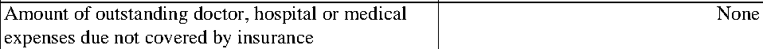 |
| debts-11 | funeral_expenses_paid | Amount of funeral expenses paid | $9,840.15 | 9840.15 | 1 | yes | 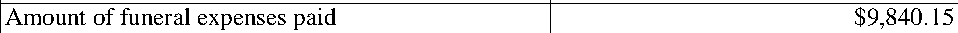 |
| debts-12 | funeral_expenses_outstanding | Amount of funeral expenses still outstanding | None | 0.00 | 1 | yes |  |
| debts-13 | credit_card_balances | Amount of credit card balances—not paid off by credit card insurance | None | 0.00 | 1 | yes | 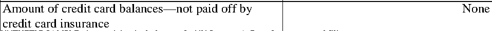 |
| debts-14 | business_engaged_flag | At the time of death, was the decedent engaged in any business? | No | - | 2 | yes | 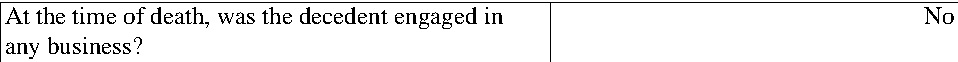 |
| debts-15 | business_liabilities_outstanding | Amount of any outstanding business liabilities payable by decedent and/or his estate | None | 0.00 | 2 | yes | 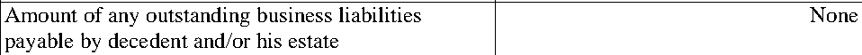 |
| debts-16 | public_assistance_received | Amount of any federal, state or city public assistance which the decedent (or any distributee) ever received | None | 0.00 | 2 | yes | 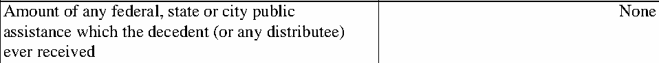 |

## Header fields

| Field | Value | Status | Page / bbox |
|---|---|---|---|
| court | SURROGATE’S COURT OF THE STATE OF NEW YORK | extracted | p1 [72.0, 74.2, 368.99, 86.2] |
| county | Kings | extracted | p1 [72.0, 88.2, 179.99, 100.2] |
| proceeding_type | Probate | extracted | p1 [78.0, 108.2, 219.97, 120.2] |
| decedent | Margaret Holloway | extracted | p1 [78.0, 136.2, 172.31, 148.2] |
| document_title | AFFIDAVIT TO DISPENSE WITH THE FILING OF A BOND | extracted | p1 [375.0, 136.2, 550.64, 161.2] |
| file_no | 2026-0000/A | extracted | p1 [361.0, 177.2, 467.33, 189.2] |
| petitioner | Daniel R. Holloway | extracted | p1 [84.0, 260.2, 279.65, 272.2] |
| petitioner_roles | distributee, petitioner, proposed_executor | extracted | - |
| petitioner_address | 48 Example Street, Apt 2B, Springfield, IL 62701 | extracted | - |
| decedent_age | 88 | extracted | p2 [151.31, 186.2, 231.62, 198.2] |
| sworn_date | 2026-03-03 | extracted | p2 [72.0, 433.2, 300.96, 445.2] |
